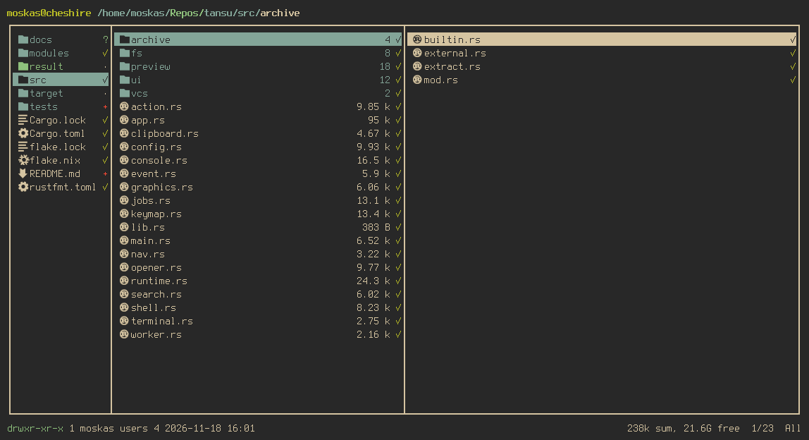
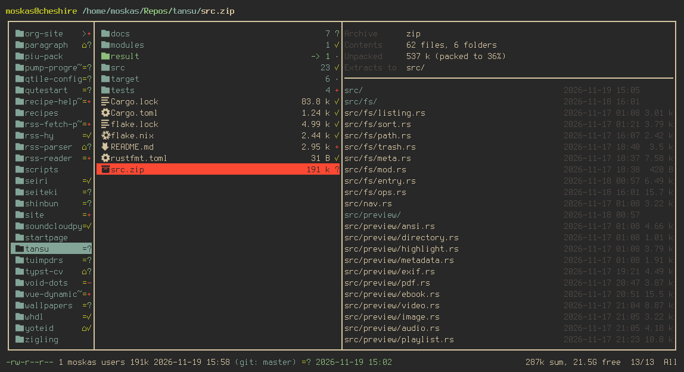
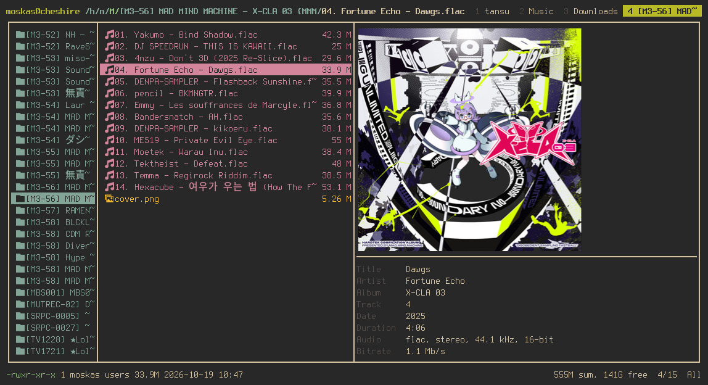
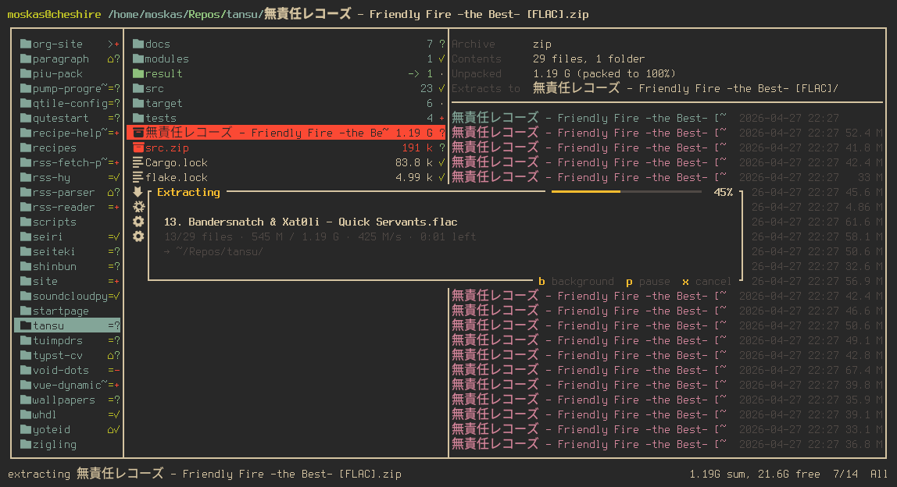
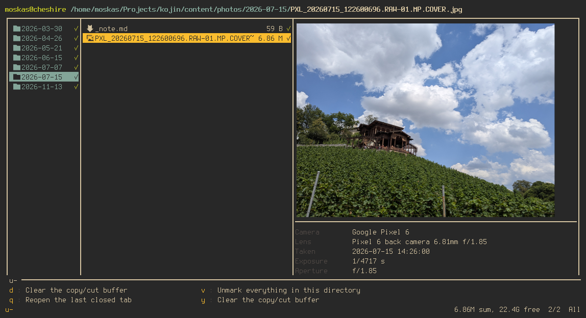

# tansu

A terminal file manager with Miller columns, in the spirit of ranger. Written in Rust with
ratatui and crossterm.

| | |
|:-:|:-:|
|  |  |
| Miller columns with icons and git status | Image preview with EXIF details |
|  |  |
| Archive listing and extraction target | Tabs with their activity in the header |
|  |  |
| Background tasks with progress | Key hints for unfinished sequences |

## Features

- ranger's layout and key bindings, with mouse support and a which-key popup
- Previews for text (highlighted by bat), images, video, PDF, audio, playlists, ebooks and
  archives
- Git status markers on every entry
- Tabs, marks, copy, move, trash and archive extraction as background tasks
- A command line with fuzzy search, ranger-style shell macros and zoxide jumps
- TOML configuration and a Home Manager module

## Install

```sh
nix run .                 # with Nix, preview tools included
cargo build --release     # without Nix, Rust 1.90+
./target/release/tansu [path]
```

Optional programs such as `bat`, `ffmpeg`, `poppler` and 7-Zip enable more previews. See
[Installation](docs/installation.md) for the full list and the Home Manager module.

## Basics

| Keys                  | Action                                   |
|-----------------------|------------------------------------------|
| `h` `j` `k` `l`       | Parent, down, up, enter or open          |
| `<Space>`             | Mark and move down                       |
| `yy` / `dd` / `pp`    | Copy / cut / paste                       |
| `dD` / `dT`           | Delete / move to the trash               |
| `x`                   | Extract an archive                       |
| `/`, `n`              | Search, next match                       |
| `:`                   | Command line                             |
| `gn`, `<Tab>`         | New tab, next tab                        |
| `?`                   | Show every binding                       |
| `q`                   | Close the tab, or quit                   |

## Documentation

- [Installation](docs/installation.md): building, optional dependencies, Home Manager
- [Usage](docs/usage.md): key bindings, tabs, mouse, marking, git markers
- [Previews](docs/previews.md): what each file type shows
- [File operations](docs/file-operations.md): paste, tasks, delete, extract, clipboard
- [Command line](docs/command-line.md): commands, search, shell macros, completion
- [Configuration](docs/configuration.md): `config.toml`, theme, key bindings
- [Architecture](docs/architecture.md): development, module layout, extension points

## Development

```sh
cargo fmt --check
cargo clippy --all-targets -- -D warnings
cargo test
```
